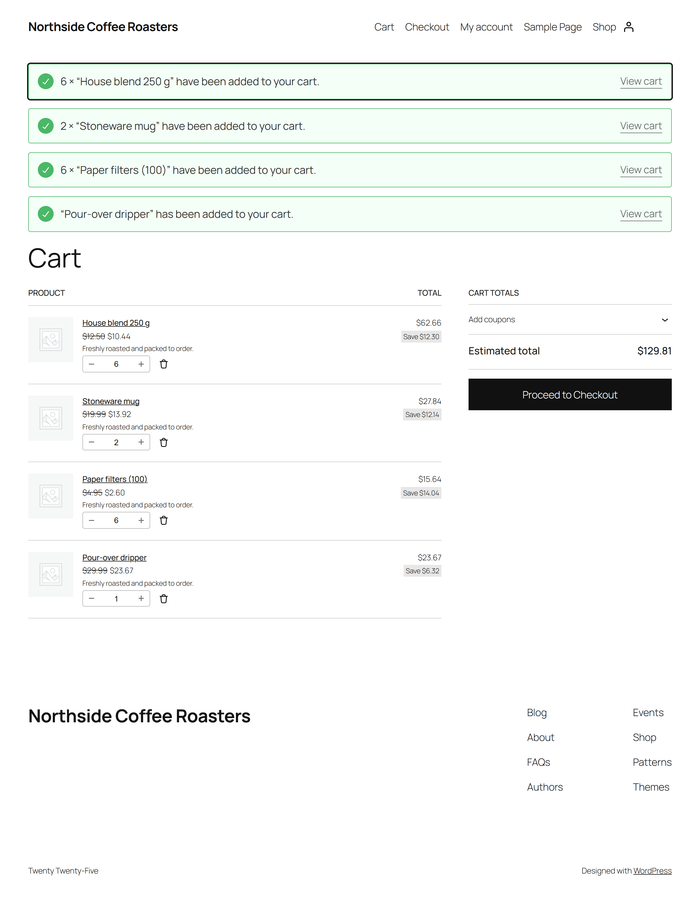
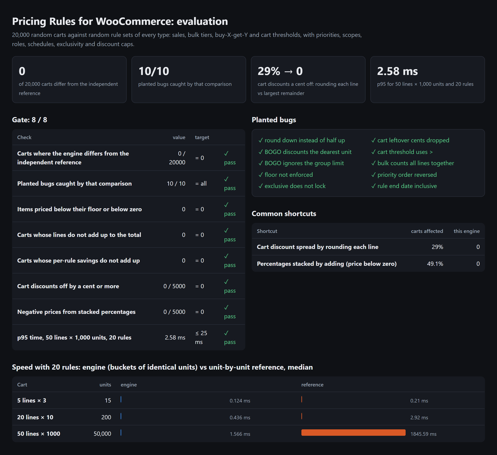
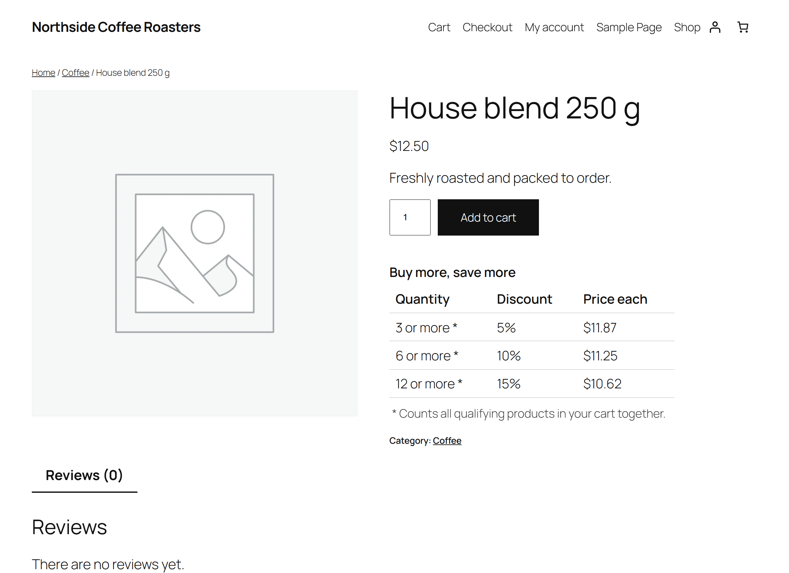
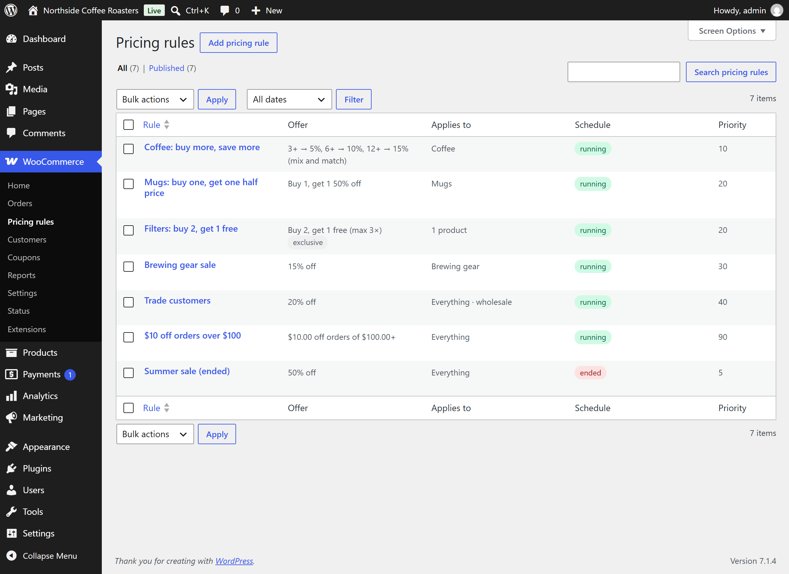

# Pricing Rules for WooCommerce

[](https://github.com/codeROCK-IZZY/woocommerce-pricing-rules/actions/workflows/ci.yml)


A WooCommerce plugin for the discounts shops actually run (bulk tiers, buy-X-get-Y, sales, trade prices and
"spend $100, save $10"), with a pricing engine that is **exact to the cent** and **proven against an independent
implementation** on 20,000 random carts.

Discount plugins usually go wrong in small ways that customers and accountants notice: "$10 off" that takes
$9.99, a 20% sale stacked on a 30% member price stacked on a 60% clearance that pushes an item below zero,
a discount that grows each time the cart recalculates, or a product page that promises $11.88 when the cart charges
$11.87. This plugin is built and tested so that none of those can happen.



## Results

From `php eval/run.php --gate` and the integration suite in a real WooCommerce.

| Check | Result |
|---|---:|
| Carts where the engine differs from a separately written unit-by-unit reference | **0 / 20,000** |
| Deliberately planted bugs that comparison catches (mutation testing) | **10 / 10** |
| WooCommerce cart totals vs the engine, random carts in a real store (WooCommerce 11.2 and 9.9) | **0 / 150 off by a cent** |
| Items priced below the configured floor or below zero | **0** |
| p95 time for a 50-line cart of 50,000 units with 20 rules | **2.6 ms** |

Two common shortcuts, measured on the same kind of random carts:

| Shortcut | Carts it gets wrong | This engine |
|---|---:|---:|
| Spreading a cart discount by rounding each line's share separately | **29%** (up to 2¢ off) | 0 |
| Stacking percentages by adding them | **49%** priced below zero | 0 |

The engine groups identical units into buckets, so cost grows with lines and rules, not quantities: 2 ms against
2 seconds for the unit-by-unit reference on a 50,000-unit cart.



## Rule types

| Type | Example | How it prices |
|---|---|---|
| **Sale** | 15% off brewing gear | Percentage off each matching item. |
| **Bulk** | 3+ bags 5%, 6+ 10%, 12+ 15% | The tier reached sets the discount on every unit; counted per product or, with *mix and match*, across all qualifying products. |
| **Buy X, get Y** | Buy 2 filters, get 1 free (max 3 times) | Units sorted most expensive first and cut into groups; the cheapest units of each complete group are discounted. |
| **Cart total** | $10 off orders over $100 | When qualifying items reach the threshold, a percentage or fixed amount is spread over them in proportion to price, with leftover cents assigned by largest remainder, so "$10 off" is exactly $10.00. |

Every rule can be limited to **products** and **categories**, **customer roles** (including guests, for trade
pricing), and a **schedule**; rules run in **priority** order, percentages **compound** on the price left by earlier
rules, an **exclusive** rule stops later rules touching the items it discounted, and a store-wide **cap** keeps any
item above a minimum share of its normal price.



## How it works

```
WooCommerce cart ──► woocommerce_before_calculate_totals (priority 20)
                       │  capture each item's original price once per request
                       ▼
                     PricingEngine (pure PHP, integer cents)
                       │  buckets of identical units; rules in (priority, id) order
                       ▼
                     set_price(line total ÷ quantity) on each cart item
                       │  WooCommerce multiplies back and rounds the line: the exact line total
                       ▼
             cart / checkout (classic and blocks) · "You save" · order line notes
```

- **Integer cents throughout.** Each discount is rounded half up per unit, once; there is no floating-point
  arithmetic in the engine.
- **Recalculation-safe.** WooCommerce recalculates totals several times per request; the original price is captured
  once and every pass starts from it, so discounts never compound across recalculations (tested).
- **Blocks and Store API.** Prices are set on the cart items, so the cart and checkout blocks show the regular price
  struck through, and orders placed through either checkout carry the discount.
- **Orders keep the record.** Each order line notes which rules applied and how much each saved; the order stores the
  total saving for reporting.
- **Rules are a private post type** under WooCommerce → Pricing rules, validated on save (an invalid rule is refused
  with a reason, never half-applied), cached until a rule changes. Store-wide options live in WooCommerce → Settings →
  Products → Pricing rules. HPOS and cart/checkout blocks compatibility are declared.

Design decisions are recorded in [docs/adr](docs/adr).



## Testing strategy

The interesting question for a pricing engine is not "does it pass the examples I thought of" but "is it right on
carts I did not think of". So:

1. **Hand-worked scenarios** (unit tests): each expected amount computed by hand, including rounding at half cents.
2. **A second implementation** (`eval/ReferencePricer.php`): slow, one array entry per unit, sharing no code with the
   engine (its own rounding, floors, ordering, scheduling and matching). The engine must agree with it on every line
   of 20,000 seeded random carts, including deliberate boundary cases (a subtotal exactly at a threshold, a rule that
   ends exactly now).
3. **Mutation testing** (`eval/Mutants.php`): ten realistic bugs are planted in a copy of the engine (round down,
   discount the dearest BOGO item, ignore the limit, skip the floor, ignore exclusivity, drop leftover cents, `>`
   instead of `>=`, wrong tier counting, reversed priority, inclusive end date). The comparison must catch every one;
   the first version missed four, which is how the reference became independent and the boundary cases were added.
4. **Inside WooCommerce**: 150 random carts in a real store, where WooCommerce's own line and cart totals must equal
   the engine's to the cent, plus orders, role pricing, schedules, the product-page table and the Store API used by
   the cart and checkout blocks.

## Run it

```bash
docker compose up -d
bash tests/integration/run.sh          # installs WordPress and WooCommerce, a demo catalogue and rules, runs every check
# http://127.0.0.1:8080/wp-admin  (admin / admin)
```

Or install it in a WooCommerce 9.9+ store (WordPress 6.7+, PHP 8.1+): copy the folder to `wp-content/plugins/`,
activate **Pricing Rules for WooCommerce**, then add rules under **WooCommerce → Pricing rules**.

```bash
composer install
vendor/bin/phpunit                      # hand-worked scenarios, validation, 1,000-cart property test
vendor/bin/phpcs && vendor/bin/phpstan analyse
php eval/run.php --gate                 # 20,000 carts, mutants, shortcuts, speed → eval/reports/
```

## Project layout

```
pricing-rules-for-woocommerce.php   plugin header, HPOS and blocks compatibility
src/Engine/                         Rule, Line, Context, PricingEngine, Bucket, Result (no WordPress calls)
src/Woo/                            cart hook, storefront and order display, rule storage
src/Admin/                          rule editor meta box, list columns, WooCommerce settings section
eval/                               reference implementation, random carts, mutants, report
tests/unit/ tests/integration/
```

## Documentation

- [Architecture decisions](docs/adr)
- [Known limitations](docs/known-limitations.md)

Store, product names and prices in the tests and screenshots are invented.

## License

GPL-2.0-or-later, like WordPress and WooCommerce.
